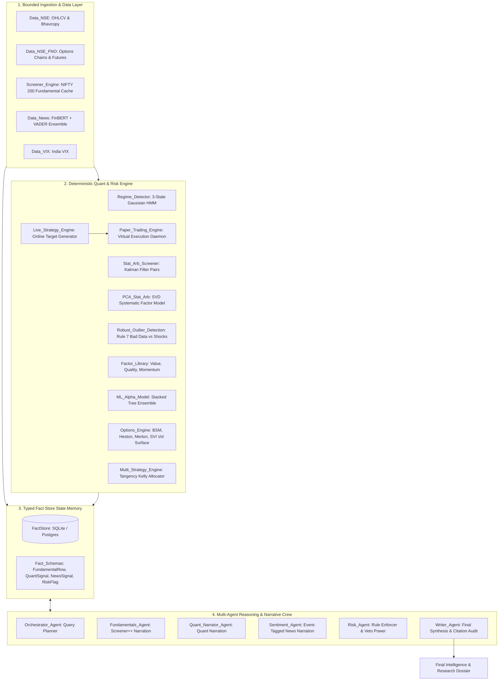

# ARTHA: Production-Grade Market Intelligence Proof of Concept

**Status**: Architecture, Quantitative Engine, Virtual Execution & Agent Crew Complete  
**Target Universe**: Indian Equities (NSE NIFTY 200, F&O) & Commodities (MCX)  
**Governing Standing Contract**: `AGENTS.md`  

---

## Executive Summary
**ARTHA** is an institutional-grade financial intelligence and quantitative decision engine designed for Indian markets. It rejects the naive industry trend of prompting an LLM to predict market movements or execute trades. Instead, ARTHA establishes a rigorous, decoupled architecture where:

1. **Deterministic Quantitative Models** (inspired by statistical arbitrage, Hidden Markov Models, and Ledoit-Wolf shrinkage) compute all numerical signals, factor ranks, volatility surfaces, and portfolio allocations.
2. **An Asynchronous Fact Store** mediates all inter-agent communication via strongly typed Pydantic contracts, eliminating context collapse and sequential prompt-stacking.
3. **A Specialized Agent Crew** (orchestrated with tiered LLM routing) acts solely as an analytical reasoning and narrative synthesis layer, explaining pre-computed facts in the style of *Harvey AI* over structured legal documents or *Screener.in* over financial statements.
4. **A Virtual Paper Trading Daemon** simulates real-time market execution during NSE trading hours with realistic slippage, transaction costs, and margin tracking — under strict adherence to SEBI retail algorithmic trading guidelines with zero live capital risk.

---

## The Core Failures of Standard "AI Trading" Systems

| Failure Mode in Naive LLM Systems | How ARTHA Solves It Architecturally |
| :--- | :--- |
| **Context Window Collapse** | **Fact Store Architecture**: Agents never pass raw transcripts or growing prompts. They read and write discrete typed records (`FactType`) with deterministic IDs. |
| **Numeric Hallucination** | **AGENTS.md Rule 1 (Zero Math by LLMs)**: All statistics, Sharpe ratios, z-scores, and prices are computed by Python/SciPy/Statsmodels. LLMs only narrate verified facts. |
| **Silent Overfitting & Look-Ahead Bias** | **Purged Walk-Forward Gate (Rule 6)**: Signals must pass walk-forward out-of-sample backtesting with purge gaps before `validated=True` is assigned. |
| **Spurious Outlier Handling** | **AGENTS.md Rule 7**: Robust MAD detection catches ingestion tape errors while preserving genuine market shocks and circuit halts for regime detection. |
| **Quota & Rate-Limit Collapses** | **Tiered Model Routing (Rule 3)**: Cheap 8B models handle row extraction and narration; deep models are reserved strictly for the single final synthesis call. |
| **Autonomous Regulatory Liability** | **SEBI Compliance & Human-in-the-Loop (Rule 9)**: No autonomous live orders. Execution is virtual paper trading; live order paths require explicit human approval. |

---

## Top-Level Architecture

---

## The Six Core Pillars

### Pillar 1: Ingestion & Data Hygiene
- [[Data_NSE]]: Ingests historical OHLCV and daily bhavcopy feeds, audited with MAD-based outlier filters.
- [[Data_NSE_FNO]]: Scrapes live NSE option chain ladders and futures curves using `nselib` and direct cookie-hydrated NSE sessions.
- [[Screener_Engine]]: SQLite-backed fundamental cache tracking 18+ ratios across the NIFTY 200 universe for rapid sector and valuation screening.
- [[Data_News]]: Dual ensemble combining local transformer **FinBERT** (65%) and finance-augmented **VADER** (35%) with directional confidence metrics. Zero LLM tokens consumed for sentiment scoring.
- [[Data_VIX]]: India VIX volatility index tracking for volatility regime normalization.

### Pillar 2: Deterministic Quant Backbone
- [[Regime_Detector]]: 3-state Hidden Markov Model classifying market dynamics into `BULL`, `BEAR`, or `SIDEWAYS`.
- [[Stat_Arb_Screener]] & [[PCA_Stat_Arb]]: Dual statistical arbitrage approaches combining time-varying Kalman filter cointegration with cross-sectional SVD factor decomposition.
- [[Robust_Outlier_Detection]]: Centralized operationalization of AGENTS.md Rule 7. Separates bad data (3-signal detection) from genuine price discovery and NSE circuit freezes ($\pm 5\%, \pm 10\%, \pm 20\%$).
- [[Options_Engine]]: Institutional options suite featuring:
  - Analytical Black-Scholes-Merton and Barone-Adesi-Whaley American pricing.
  - [[Options_Heston_Model]]: Semi-analytical characteristic function pricing for stochastic volatility.
  - [[Options_Merton_Model]]: Poisson jump-diffusion pricing for fat-tailed discontinuous market shocks.
  - [[Volatility_Surface_Analysis]]: Jim Gatheral (2004) SVI surface parameterization and butterfly/calendar arbitrage checks.
- [[Multi_Strategy_Engine]]: Combines return streams using Ledoit-Wolf shrinkage covariance, volatility targeting (10% annualized), and Kelly-optimal tangency portfolio weighting. Verified on a **12.4-year out-of-sample backtest achieving Sharpe 0.97 - 1.00 and Sortino 1.33** (see [[Backtest_Evolution_Report]]).

### Pillar 3: Live Strategy & Virtual Paper Trading
- [[Live_Strategy_Engine]]: Incremental online version of the multi-strategy backtest. Periodically retrains ML models (30-day cadence) and HMM regime detectors (90-day cadence) while streaming `PortfolioTarget` weights.
- [[Paper_Trading_Engine]]: Virtual execution daemon operating during NSE hours (09:15 - 15:30 IST). Runs on a dedicated thread, persists state to SQLite WAL, models 10 bps slippage, and tracks real-time mark-to-market without touching broker APIs.
- [[Security_Auth]]: Protects execution and portfolio state endpoints using fail-closed Supabase JWT token verification.

### Pillar 4: The Typed Fact Store (State Persistence)
- Implemented in `app/factstore/store.py` with dual backends (SQLite for local workflows, PostgreSQL for enterprise deployments).
- Stores typed Pydantic models ([[Fact_Schemas]]):
  - `FundamentalRow`: Row-level reported corporate data with mandatory non-empty `source` citations.
  - `QuantSignal`: Mathematical alpha signals containing backtested Sharpe and explicit `validated` booleans.
  - `NewsSignal`: Ensemble sentiment score, headline volume, and classified event tags.
  - `RiskFlag`: Portfolio drawdown breaches and SEBI compliance alerts.
  - `NarrativeFact`: Agent-generated explanatory text citing specific `referenced_fact_ids`.

### Pillar 5: Specialized Agent Crew (Reasoning & Narration)
- [[Orchestrator_Agent]]: Decomposes incoming user inquiries into execution plans without touching raw data.
- [[Fundamentals_Agent]]: Ingests financial statements and OHLCV market metrics, persists facts, and generates Screener-style row-by-row narratives citing Fact IDs.
- [[Quant_Narrator_Agent]]: Translates raw z-scores, regime probabilities, and option Greeks into plain English.
- [[Sentiment_Agent]]: Narrates news flow and structural market events (earnings, policy decisions, supply shocks) using cheap model tiers.
- [[Risk_Agent]]: Enforces hard stops, drawdown ceilings, and regulatory concentration limits.
- [[Writer_Agent]]: Deep-model synthesis agent that drafts the final comprehensive dossier and executes an automated citation audit (`check_citations`) against the Fact Store.

### Pillar 6: Hard Traceability & Testing Gate
- **Traceability Gate (`tests/test_factstore_citations.py`)**: An automated test inspects all generated reports. If any numerical figure in the text cannot be resolved to a specific `FactStore` record with a valid `source`, the test fails and the report is rejected.
- **Unit & Simulation Coverage**: Comprehensive test suites for all quant modules (`test_pca_statarb.py`, `test_robust_outliers.py`, `test_live_strategy.py`, `test_screener.py`, `test_sentiment_agent.py`).

---

## Master Node References
- **Index & Repository Map**: [[ARTHA_Index]]
- **Empirical Backtest Results**: [[Backtest_Evolution_Report]]
- **Data Layer Architecture**: [[Data_Layer]]
- **Quant Engine Architecture**: [[Quant_Engine]]
- **Fact Store State Management**: [[Fact_Store]]
- **Agent Crew Orchestration**: [[Agent_Crew]]
- **Virtual Execution & Daemon**: [[Paper_Trading_Engine]]
