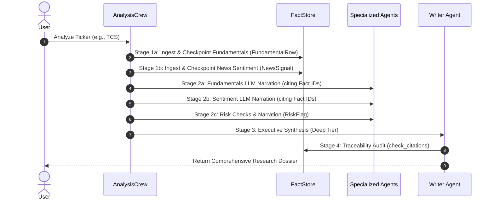

# Agent Crew Orchestration

**Status**: Implemented & Tested  
**Path**: `app/agents/orchestrator.py`, `app/crew/analysis_crew.py`  

The Agent Crew is the reasoning and reporting layer of ARTHA. Unlike typical CrewAI setups where agents pass massive conversational context windows or sequential transcripts to one another, ARTHA strictly uses asynchronous, Fact Store-mediated communication (**AGENTS.md Rule 2: No Sequential Prompt-Stacking**).

---

## Tiered Model Routing (AGENTS.md Rule 3)
ARTHA uses tiered model routing to eliminate API quota exhaustion:
- **Cheap Models (8B Class - e.g., Llama 3 8B, Gemini Flash)**:
  - [[Orchestrator_Agent]]: Query decomposition and task planning.
  - [[Fundamentals_Agent]]: Row-level financial statement extraction and Harvey-style narration.
  - [[Quant_Narrator_Agent]]: Plain-English translation of deterministic quant signals and regimes.
  - [[Sentiment_Agent]]: Interpretation of FinBERT+VADER news sentiment and event classification.
- **Mid-Tier Models (e.g., Llama 3.3 70B, GPT-4o-mini)**:
  - [[Risk_Agent]]: Evaluates drawdowns, volatility ceilings, and SEBI regulatory compliance.
- **Deep Models (e.g., Llama 3 70B, GPT-4o, Claude 3.5 Sonnet)**:
  - [[Writer_Agent]]: Executed **exactly once per job** for final synthesis, followed by automated post-generation citation auditing.

---

## Execution Pipeline (`AnalysisCrew.run_analysis`)
The crew coordinates a multi-stage execution pipeline:

---

## The Crew Members
1. **[[Orchestrator_Agent]]**:
   - Financial research operations planner. Decomposes queries into symbol universes, fiscal periods, and required fact collectors. Never performs analysis directly.
2. **[[Fundamentals_Agent]]**:
   - Ingests financial statements and OHLCV market metrics. Persists facts to the Fact Store and writes Screener-style row-by-row narratives citing Fact IDs.
3. **[[Quant_Narrator_Agent]]**:
   - Explains statistical arbitrage z-scores, HMM regime transitions, factor quintiles, and option Greeks.
4. **[[Sentiment_Agent]]**:
   - Reads pre-computed FinBERT+VADER ensemble scores, classifies dominant corporate/macro events, and produces thematic news summaries.
5. **[[Risk_Agent]]**:
   - Enforces risk limits across portfolio drawdowns, volatility targets, and regulatory bounds. Has veto authority via `CRITICAL` risk flags.
6. **[[Writer_Agent]]**:
   - Generates the final executive intelligence report. Enforces **AGENTS.md Rule 10**: every single number must map to a `FactStore` record with a valid source.
