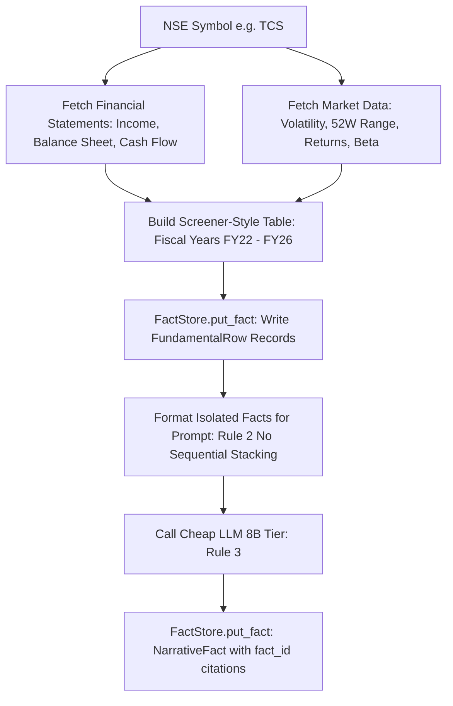

# Fundamentals Agent (Screener++ Row-Level Analysis)

**Status**: Implemented & Tested  
**Path**: `app/agents/fundamentals_agent.py`  
**Test Suite**: `tests/test_fundamentals_narrator.py`  

## Overview
The **Fundamentals Agent** provides row-level structured fundamental analysis for Indian equities (NSE) in the tradition of *Screener.in*, narrated the way *Harvey AI* narrates over structured legal data.

> [!IMPORTANT]
> **Non-Negotiable Constraints (AGENTS.md)**:
> - **Rule 1 (Zero Math by LLM)**: The agent **NEVER computes, estimates, or invents a number**. All metrics come from the verified data layer (`yfinance` financial statements and historical OHLCV) and are persisted into the [[Fact_Store]] as `FundamentalRow` records with non-empty `source` citations.
> - **Rule 10 (Traceability Gate)**: Every numeric claim in the generated narrative must explicitly cite a specific `fact_id` (`[fact_id: XXXXXXXX]`).

---

## Technical Architecture



### 1. The Data Gathering Pipeline (`run_fundamentals_analysis`)
Executes deterministically in Stage 1a of `AnalysisCrew`:
1. **Financial Statements**: Extracts multi-year rows (Income Statement, Balance Sheet, Cash Flow):
   - Revenue, Operating Profit (EBITDA), Net Income, EPS.
   - Operating Margin (OPM %), Net Margin (NPM %), Return on Equity (ROE %).
   - Total Debt, Cash & Equivalents, Debt-to-Equity ratio, Working Capital.
   - Operating Cash Flow, Free Cash Flow, Capex.
2. **Market-Derived Metrics**: Supplemented with OHLCV data to compute current trading realities:
   - 52-Week High, 52-Week Low, Current Market Price (CMP).
   - Realized Annualized Volatility, 1-Year / 3-Year Annualized Returns.
3. **Fact Store Checkpoint (Rule 5)**: Every single metric for every fiscal year is immediately written to the Fact Store as a `FundamentalRow`:
   ```python
   FundamentalRow(
       job_id=job_id,
       source="yfinance:income_stmt",
       symbol="TCS",
       fiscal_year=2024,
       metric_name="operating_revenue",
       value=240893.0,
       unit="INR_CRORE",
       period_type="ANNUAL",
       as_of=date(2024, 3, 31),
   )
   ```

---

### 2. The Harvey-Style Narration Layer
- **Model Tier**: Cheap 8B-class model (`get_cheap_llm()`, Rule 3).
- **Style**: Senior equity research analyst specializing in Indian corporate filings.
- **Content**:
  - Explains year-over-year trends (e.g., why margin compression occurred despite revenue expansion).
  - Highlights balance sheet stability (debt-to-equity trajectory, free cash flow conversion).
  - Notes capital allocation discipline (capex vs. dividend payouts).
- **Traceability**: Every stated figure references its origin Fact ID (`[fact_id: XXXXXXXX]`). Any missing metric is explicitly acknowledged as unavailable rather than estimated.

---

## Key Functions & Exports
- `run_fundamentals_analysis(symbol, job_id, store, start_fy=2022, end_fy=None)`: Deterministic extraction, metric computation, and Fact Store checkpointing.
- `create_fundamentals_agent()`: Instantiates the CrewAI agent configured with the cheap LLM tier.
- `fundamentals_to_dataframe(facts)`: Formats `FundamentalRow` records into a Screener.in-style matrix.

---

## System Connections
- **Data Ingestion**: Directly consumes [[Data_Fundamentals]] and [[Data_NSE]].
- **Screener Synergy**: Cross-references peer metrics via [[Screener_Engine]].
- **Fact Store**: Checkpoints `FundamentalRow` (FactType 1) and `NarrativeFact` (FactType 5) into [[Fact_Store]].
- **Executive Report**: The [[Writer_Agent]] reads the fundamental narrative for inclusion in the final report.
