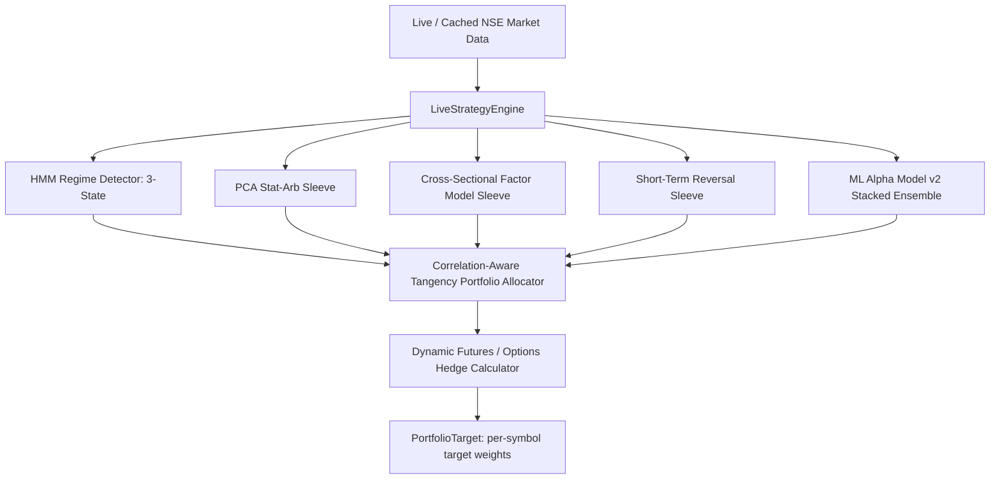

# Live Strategy Engine

**Status**: Implemented & Tested  
**Path**: `app/quant/live_strategy.py`  
**Test Suite**: `tests/test_live_strategy.py`  

## Overview
The **Live Strategy Engine** transforms the batch backtest architecture of `scripts/run_multi_strategy_backtest.py` into an incremental, stateful, online execution engine. It coordinates multiple independent quant strategies, monitors regime transitions in real time, and outputs aggregate target portfolio weights (`PortfolioTarget`) for the [[Paper_Trading_Engine]].

---

## Architectural Workflow



### 1. Engine Lifecycle
1. **`initialize(historical_prices)`**:
   - Ingests 2+ years of historical data for the universe.
   - Fits the Gaussian Hidden Markov Model (`RegimeDetector`) to classify market states: `BULL`, `BEAR`, or `SIDEWAYS`.
   - Trains the [[ML_Alpha_Model]] stacked ensemble (`HistGradientBoosting` + `RandomForest` + `Ridge`).
   - Persists trained models to disk (`data_cache/models/checkpoint.pkl`).
2. **`compute_targets(current_prices)`**:
   - Updates regime state probability based on latest price/volatility bar.
   - Computes signed per-symbol weights from each sub-strategy:
     - `pca_statarb`: Idiosyncratic residual z-scores.
     - `factor_model`: Top/bottom quintile composite alpha ranking.
     - `momentum`: Regime-conditioned trend following.
     - `ml_alpha`: Cross-sectional rank predictions.
   - Combines sub-strategies using Ledoit-Wolf shrinkage covariance and tangency portfolio weighting from [[Multi_Strategy_Engine]].
   - Applies volatility targeting (10% annualized) and position concentration limits (max 35% per strategy, min 5%).
3. **`retrain_if_due()`**:
   - Manages model retraining cadences to prevent concept drift:
     - **ML Alpha Ensemble**: Retrained every 30 trading days.
     - **HMM Regime Detector**: Retrained every 90 trading days.

---

## Data Models
- **`StrategySignal`**: Signed allocations emitted by a single strategy sleeve:
  ```python
  @dataclass
  class StrategySignal:
      name: str
      weights: dict[str, float]  # symbol -> signed weight
      sharpe_estimate: float
      last_computed: str
  ```
- **`PortfolioTarget`**: Combined portfolio target passed to the execution daemon:
  ```python
  @dataclass
  class PortfolioTarget:
      weights: dict[str, float]          # symbol -> target weight (0.0 to 1.0)
      strategy_signals: list[StrategySignal]
      regime: str                         # BULL, BEAR, SIDEWAYS
      hedge_ratio: float                  # Futures / index hedge percentage
      allocation_weights: dict[str, float]
      computed_at: str
  ```

---

## System Connections
- **Quant Backtest Foundation**: Mirror of `scripts/run_multi_strategy_backtest.py` and [[Multi_Strategy_Engine]].
- **Sub-Strategies**: Combines [[PCA_Stat_Arb]], [[Factor_Backtester]], [[ML_Alpha_Model]], and [[Regime_Detector]].
- **Execution**: Ingested by [[Paper_Trading_Engine]] to generate virtual rebalancing orders.
- **Compliance**: AGENTS.md Rule 1 (purely deterministic numeric calculation) and Rule 8 (risk-adjusted Sharpe optimization).
