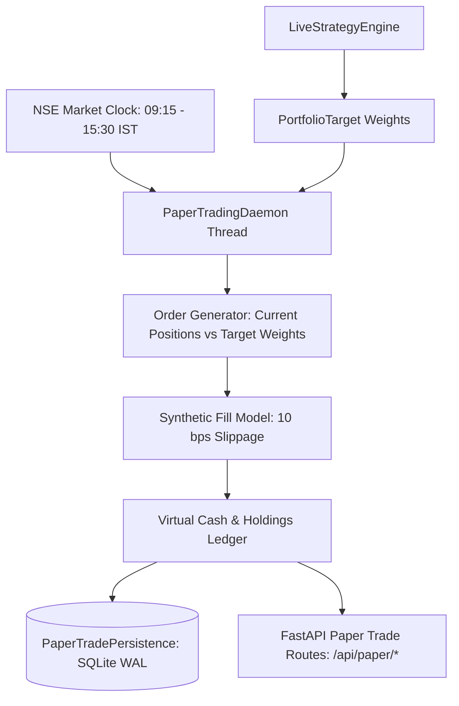

# Paper Trading Daemon & Virtual Execution Engine

**Status**: Implemented & Tested  
**Path**: `app/quant/paper_trade.py`, `app/api/paper_trade_routes.py`  
**Test Suite**: `tests/test_live_strategy.py`  

## Overview
The **Paper Trading Daemon** provides a continuous, institutional-grade virtual live execution framework for ARTHA. It executes the multi-strategy portfolio signals against real-time (or 15-minute delayed) market feeds during NSE trading hours (09:15 to 15:30 IST) without committing real capital.

### Regulatory & Architectural Constraints
- **AGENTS.md Rule 9 (No Autonomous Live Orders)**:
  - All executions are strictly virtual/synthetic fills against an internal cash ledger.
  - Zero broker API imports or order placement endpoints exist in this module.
  - Live order submission requires an explicit human-in-the-loop authorization gate and compliance with SEBI retail algorithmic-trading guidelines (Algo-ID tagging, registered static IP, sub-10 orders/sec).
- **AGENTS.md Rule 11 (Not Investment Advice)**:
  - Generates paper performance logs and simulated allocations; explicitly framed as research.

---

## Technical Architecture

### 1. Daemon Lifecycle & States
The background daemon runs on a dedicated Python thread (`threading.Thread`):
- `STOPPED`: Daemon is manually halted.
- `SLEEPING`: Outside NSE trading hours (before 09:15 IST or after 15:30 IST, or on exchange holidays).
- `RUNNING`: Actively polling market data, rebalancing portfolio targets, and managing fills.
- `ERROR`: Exception state with automated logging and recovery attempts.

### 2. Execution & Fill Simulation
- **Order Generation**: Compares current position weights against target weights from [[Live_Strategy_Engine]]. Computes delta quantities:
  $$\Delta Q_i = \left\lfloor \frac{w_i \times \text{NAV}_{\text{virtual}}}{P_i} \right\rfloor - Q_i$$
- **Slippage & Cost Modeling**:
  $$\text{Fill Price} = \begin{cases} P_{\text{market}} \times (1 + \text{Slippage}_{\text{bps}} \times 10^{-4}) & \text{if BUY} \\ P_{\text{market}} \times (1 - \text{Slippage}_{\text{bps}} \times 10^{-4}) & \text{if SELL} \end{cases}$$
  Default slippage is 10 bps (5 bps half-spread + 5 bps market impact).
- **Cash & Margin Accounting**: Prevents short-selling beyond allocated margin and enforces cash conservation.

### 3. Persistence Layer (`PaperTradePersistence`)
- Backed by SQLite in Write-Ahead Logging (`WAL`) mode.
- Survives server and daemon restarts without state loss.
- Stores:
  - `positions`: Current holdings (`symbol`, `quantity`, `avg_entry_price`, `current_price`, `unrealized_pnl`).
  - `virtual_trades`: Audit log of all historical executions (`timestamp`, `side`, `quantity`, `fill_price`, `slippage_bps`, `pnl`).
  - `nav_history`: Daily NAV snapshots for performance charting and drawdown tracking.
  - `daemon_state`: Operational metadata, last signal timestamp, active regime, and hedge ratio.

---

## FastAPI Endpoints (`app/api/paper_trade_routes.py`)
All endpoints are secured via Supabase JWT authentication ([[Security_Auth]]):
- `POST /api/paper/start`: Starts the background daemon thread.
- `POST /api/paper/stop`: Gracefully stops the daemon thread.
- `GET /api/paper/status`: Returns current `DaemonStatus` (state, NAV, PnL, regime, open position count).
- `GET /api/paper/positions`: Lists all open holdings and their real-time mark-to-market.
- `GET /api/paper/trades`: Retrieves paginated history of virtual trades.
- `GET /api/paper/nav-history`: Returns time series of portfolio NAV for frontend equity curves.
- `POST /api/paper/reset`: Resets portfolio to initial virtual capital (default ₹1,00,00,000 / 1 Crore).

---

## System Connections
- **Signal Provider**: Consumes `PortfolioTarget` from [[Live_Strategy_Engine]].
- **Market Data**: Quotes fetched via [[Data_NSE]] and [[Data_NSE_FNO]].
- **Authentication**: Protected by `get_current_user` in [[Security_Auth]].
- **Frontend UI**: Renders in the dedicated Paper Trading dashboard (`frontend/src/pages/PaperTrading.jsx`).
