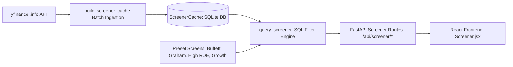

# Screener Engine & Fundamental Cache

**Status**: Implemented & Tested  
**Path**: `app/data/screener_cache.py`, `app/api/screener_routes.py`  
**Test Suite**: `tests/test_screener.py`  

## Overview
The **Screener Engine** powers ARTHA's Screener.in-style fundamental analysis and filtering interface. It maintains a high-performance SQLite cache of 18+ fundamental metrics across the NIFTY 200 universe, enabling sub-millisecond multi-attribute queries, custom screening formulas, and preset investment filters.

---

## Technical Architecture

### 1. Ingestion & Cache (`build_screener_cache`)
- **Universe**: NIFTY 200 constituents covering large-caps, mid-caps, and prominent financials.
- **Data Source**: Direct ingestion of audited `.info` dictionaries from `yfinance`.
- **Performance Rationale**: Ingesting pre-calculated market ratios avoids recalculating ratios from raw quarterly filings on every user query, ensuring consistent metrics with commercial financial data vendors.
- **Cache TTL**: 24-hour refresh schedule with automated staleness detection.

### 2. Supported Metrics Catalog (`METRIC_CATALOG`)
| Key | Display Name | Unit | Transform | Filterable |
| :--- | :--- | :--- | :--- | :--- |
| `market_cap` | Market Cap | INR Crore | Scale to Crores | Yes |
| `current_price` | CMP | INR | Raw | Yes |
| `pe` | PE Ratio (TTM) | Ratio | Raw | Yes |
| `forward_pe` | Forward PE | Ratio | Raw | Yes |
| `pb` | Price / Book | Ratio | Raw | Yes |
| `eps` | EPS (TTM) | INR | Raw | Yes |
| `book_value` | Book Value | INR | Raw | Yes |
| `dividend_yield` | Dividend Yield | Percent | Raw | Yes |
| `roe` | Return on Equity | Percent | Pct to 100 | Yes |
| `roa` | Return on Assets | Percent | Pct to 100 | Yes |
| `debt_to_equity` | Debt / Equity | Ratio | Raw | Yes |
| `revenue_growth` | Revenue Growth | Percent | Pct to 100 | Yes |
| `profit_margin` | Profit Margin | Percent | Pct to 100 | Yes |
| `operating_margin`| Operating Margin | Percent | Pct to 100 | Yes |
| `free_cashflow` | Free Cash Flow | INR Crore | Scale to Crores | Yes |
| `beta` | Market Beta | Ratio | Raw | Yes |
| `fifty_two_wk_high`| 52W High | INR | Raw | Yes |
| `fifty_two_wk_low` | 52W Low | INR | Raw | Yes |
| `sector` | Sector | Text | None | Filter / Group |
| `industry` | Industry | Text | None | Filter / Group |

### 3. Filter Operators (`VALID_OPERATORS`)
The query engine dynamically constructs parameter-safe SQL queries supporting:
- `gt` ($>$), `gte` ($\ge$)
- `lt` ($<$), `lte` ($\le$)
- `eq` ($=$)
- `between` ($v_1 \le x \le v_2$)

### 4. Built-In Preset Screens
1. **High ROE, Low Debt** (Quality Compounders):
   - $\text{ROE} \ge 20\%$, $\text{Debt-to-Equity} \le 0.5$, $\text{PE} \le 35$
2. **Undervalued Growth**:
   - $\text{Revenue Growth} \ge 15\%$, $\text{PE} \le 25$, $\text{ROE} \ge 15\%$
3. **High Dividend Yield**:
   - $\text{Dividend Yield} \ge 3.0\%$, $\text{PE} \le 20$, $\text{ROE} \ge 10\%$
4. **Buffett-Style Moats**:
   - $\text{Operating Margin} \ge 20\%$, $\text{ROE} \ge 20\%$, $\text{Debt-to-Equity} \le 0.3$, $\text{Free Cash Flow} > 0$

---

## FastAPI Endpoints (`app/api/screener_routes.py`)
- `POST /api/screener/query`: Evaluates dynamic list of `ScreenerFilter` objects with sorting and pagination.
- `GET /api/screener/presets`: Returns available preset screen definitions and metadata.
- `GET /api/screener/presets/{name}`: Executes a specific preset screen.
- `GET /api/screener/metrics`: Returns the catalog of screenable metrics and their units.
- `POST /api/screener/refresh`: Triggers background cache refresh for the NIFTY 200 universe.

---

## System Connections
- **Data Layer**: Sits in `app/data/screener_cache.py` as part of [[Data_Layer]].
- **Fundamentals Agent**: Synergizes with [[Fundamentals_Agent]] by providing cross-sectional sector context.
- **UI Component**: Exposed in the React frontend (`frontend/src/pages/Screener.jsx`).
