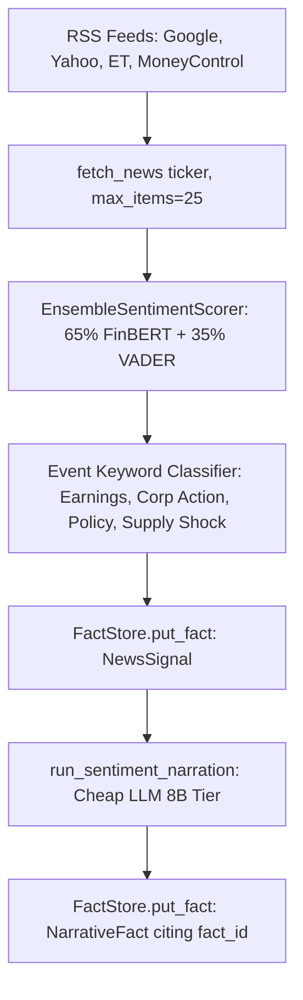

# Sentiment Agent

**Status**: Implemented & Tested  
**Path**: `app/agents/sentiment_agent.py`  
**Test Suite**: `tests/test_sentiment_agent.py`  

## Overview
The **Sentiment Agent** evaluates news flow and market sentiment across NSE equities and MCX commodities. It bridges the deterministic, local **FinBERT + VADER ensemble** data layer (`app/data/news.py`) with the [[Fact_Store]] and the [[Agent_Crew]].

In strict adherence to **AGENTS.md Rule 1**, the agent **never calculates or estimates sentiment scores using an LLM**. All sentiment mathematics are computed locally and deterministically. The LLM is used solely in a secondary narration step via the cheap model tier (Rule 3) to interpret pre-calculated facts and cite their unique IDs (Rule 10).

---

## Architecture & Workflow



### 1. Deterministic Scoring Pipeline (`run_sentiment_analysis`)
1. **Fetch & Cache**: Ingests ticker-scoped headlines via RSS feeds (10-minute TTL cache).
2. **Local Ensemble Inference**: Runs `EnsembleSentimentScorer` (FinBERT transformer + finance-augmented VADER). FinBERT outputs 3-class probabilities (`positive`, `negative`, `neutral`) while VADER handles informal text.
3. **Event Classification**: Assigns a coarse `EventType` tag using verified keyword rules:
   - `EARNINGS`: Quarterly results, EBITDA, margins, guidance, YoY/QoQ.
   - `CORPORATE_ACTION`: Dividends, buybacks, stock splits, bonuses, mergers, delisting.
   - `POLICY`: RBI, SEBI, tax, budget, interest rate decisions, regulatory circulars.
   - `SUPPLY_SHOCK`: Commodity inventory, monsoon, OPEC crude cuts, inflation (CPI/WPI).
4. **Fact Store Checkpoint (Rule 5)**: Writes a typed `NewsSignal` Pydantic object:
   ```python
   NewsSignal(
       job_id=job_id,
       source="SENTIMENT_AGENT:ensemble:ensemble",
       symbol_or_commodity=symbol,
       headline_count=len(news_items),
       sentiment_score=summary["score"],  # [-1.0, +1.0]
       event_type=dominant_event,
       as_of=date.today(),
       headlines_sample=top_headlines[:5],
   )
   ```

---

### 2. LLM Narration Layer (`run_sentiment_narration`)
- **Model Tier**: Cheap 8B-class model (`get_cheap_llm()`, Rule 3).
- **Prompt Isolation (Rule 2)**: The prompt receives only the structured `NewsSignal` table and sample headlines. It never receives raw token transcripts.
- **Traceability (Rule 10)**: The prompt strictly instructs:
  > "NEVER compute, estimate, or re-score any sentiment. Every numeric claim MUST reference the Fact ID it comes from as `[fact_id: XXXXXXXX]`."
- **Fallback**: If the LLM call fails or times out, a deterministic programmatic fallback narrative is generated.

---

## Key Functions & Exports
- `run_sentiment_analysis(job_id, store, symbol, max_headlines=25)`: Ingests news, scores with ensemble, and writes `NewsSignal` to the Fact Store.
- `run_sentiment_narration(job_id, store, symbol=None)`: Narrates persisted `NewsSignal` facts and stores `NarrativeFact`.
- `_classify_event_type(headline)`: Deterministic keyword-based event classifier.

---

## System Connections
- **Data Ingestion**: Directly consumes `app/data/news.py` (see [[Data_News]]).
- **Fact Store**: Writes `NewsSignal` (FactType 4) and `NarrativeFact` (FactType 5) into [[Fact_Store]].
- **Crew Orchestration**: Executed in Stage 1b (scoring) and Stage 2b (narration) of `AnalysisCrew` (`app/crew/analysis_crew.py`).
- **Final Report**: The [[Writer_Agent]] reads the persisted sentiment narrative and includes it in the final executive report.
